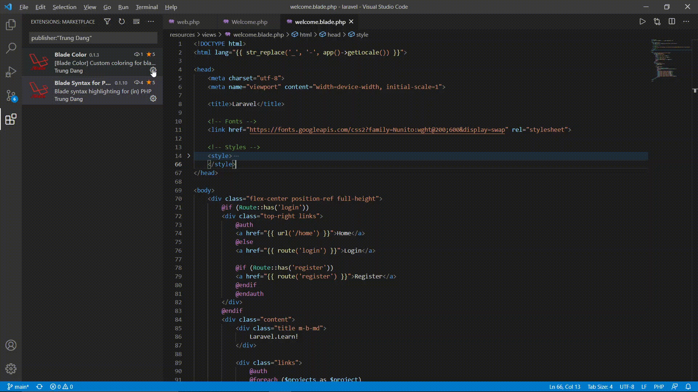

# [Blade Color](https://marketplace.visualstudio.com/items?itemName=namesmt.blade-color) `for` [blade-php](https://marketplace.visualstudio.com/items?itemName=namesmt.blade-php)

> ## ⚠️ Deprecated
> This extension is deprecated and no longer maintained. Please install
> [blade-php](https://marketplace.visualstudio.com/items?itemName=namesmt.blade-php)
> on its own instead — its built-in highlighting covers what this theme used to fix.

Blade custom coloring **for `blade-php`**.
> Fixes color-issue related to brackets in `@blade methods`

> Additionally, switch to Language Mode: `Blade` now grays out htmls, allowing even more easier debugging/navigating

## Screenshot

## User Settings

TBA

Todo:
* TBA
* **Your ideas?** (submit an github issue)

## Features

* `blade-php` coloring improve
	+ grayed-out other stuffs in `Blade` Language Mode for more easier debugging
	+ *What a shame* fix a color-issue where brackets might have color of string semantic token, which is both OCD-unfriendly and of course not good at all for reading, currently happening with all blade syntax extension on vscode :'(
* *More incoming <3*

## Blade Syntax Highlight

## Contact

Files any [issue(s)](https://github.com/NamesMT/blade-color/issues) or mail me: [trungdang6102@gmail.com](mailto:trungdang6102@gmail.com).

## Development

* `npm run validate` — manifest + theme (JSONC) validation and `include`-chain check.
* `npm run package` — build a `.vsix` locally.
* Publishing a new version is documented in [RELEASING.md](RELEASING.md).

## License

**MIT**
